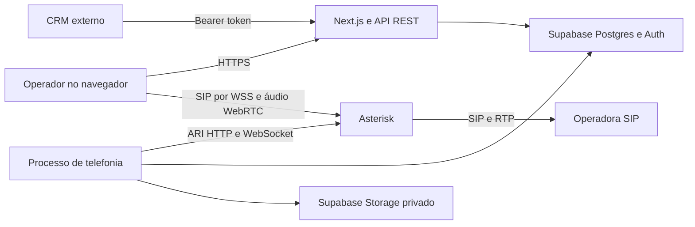

# Arquitetura

## Visão geral

Monólito modular TypeScript com dois processos do mesmo produto: aplicação Next.js e processo de telefonia. Não há divisão artificial em microsserviços. Ambos usam o mesmo contrato global `src/Typings`, versão e pacote.

## Diretórios

- `src/app`: entradas finas do framework e estilos globais.
- `src/features/Console`: composição da aplicação.
- `src/features/Dashboard`: preparação de métricas no Controller e apresentação na View.
- `src/features/Resources`: cadastros e gestão; views subdivididas por recurso.
- `src/features/Softphone`: estado e controle de SIP no Controller; telefone na View.
- `src/features/Login`: autenticação e apresentação separadas.
- `src/features/Api`: schemas no Model e roteamento de operações nos Controllers de leitura, escrita e administração.
- `src/features/Telephony`: ciclo de vida de canais e bridges.
- `src/features/TelephonyRuntime`: inicialização, lease, manutenção e agendamento.
- `src/components/ResourceDialog`: formulário de cadastro reutilizável.
- `src/hooks/useConsole`: sessão, polling, ações e importação.
- `src/services`: Supabase, autenticação, API HTTP, ARI, provisionamento, gravações e demonstração.
- `src/Typings`: tipos públicos, DTOs e interfaces globais.
- `src/utils`: normalização de telefone.
- `supabase/migrations`: fonte de verdade do schema do banco.
- `infra`: configurações Asterisk e unidade systemd.
- `worker/index.ts`: entrada do processo de telefonia.

As pastas Model contêm dados, constantes e schemas. Controllers concentram estado, transformação e ações. Views renderizam a interface. Camadas sem responsabilidade real não recebem arquivos vazios; serviços de backend não possuem View.

## Escolhas

- Next.js permite painel e API no mesmo deploy Node.js.
- Supabase Auth autentica contas; Postgres mantém a operação; Storage guarda os arquivos de áudio.
- Asterisk é o motor de voz. O banco não transporta áudio.
- SIP.js conecta o navegador ao Asterisk; chamadas externas são solicitadas à API e originadas pelo serviço ARI.
- O painel consulta um snapshot a cada 5 segundos. A voz usa eventos ARI; não depende do polling visual.
- Demonstração usa um adaptador em memória, sem persistência remota e sem chamadas.
- Discador progressivo reserva um operador antes de ligar. Não há discagem preditiva nesta versão.

## Escala inicial

Uma central, uma organização e um worker ativo. O lease no Postgres impede dois workers ativos no fluxo normal. Para alta disponibilidade e grande volume, são necessários desenho específico, filas distribuídas, testes de carga e evolução do modelo operacional. Não iniciar réplicas de worker sem considerar essa restrição.
